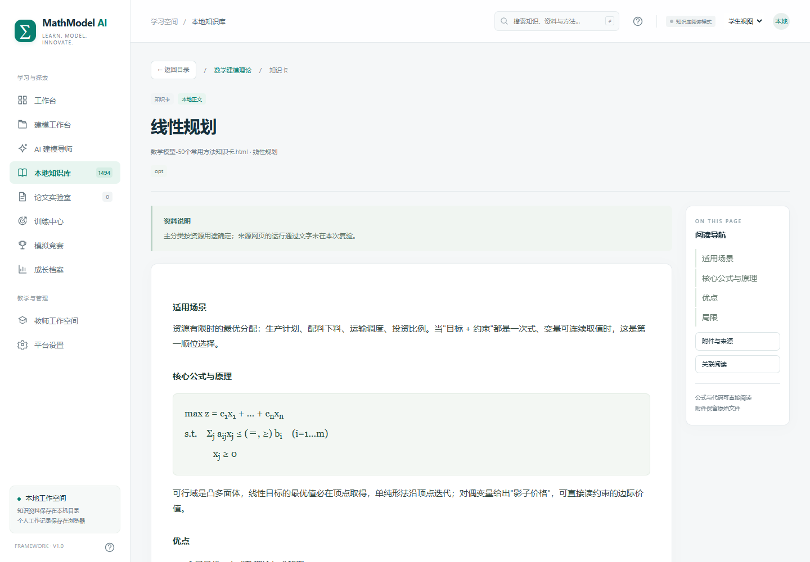

# MathModel AI · 社团数学建模知识库

保留原有工作台界面与六类分类，优先提供知识库浏览、知识卡阅读、PDF 预览、附件下载和赛题关联阅读。RAGFlow 与 Agent 接入留待下一阶段。

## 下载包含附件的完整版本

**[下载完整阅读版 ZIP（约 1.53 GB，含知识库附件）](https://github.com/morebadly/mathmodel-ai-library/releases/download/v1.2.0/MathModel-AI-Library-v1.2.0-with-resources.zip)**

[查看 Release、校验文件和资料清单](https://github.com/morebadly/mathmodel-ai-library/releases/tag/v1.2.0)

完整 ZIP 包含 **1,494 条记录、562 条可读正文、331 份去重后的本地 PDF、401 个本地附件**，以及运行所需的网页依赖。记录数包含阅读入口与外部索引，不等于独立论文篇数。

GitHub 的绿色 Code 按钮和自动生成的 Source code ZIP 只下载源码。**需要资料、PDF 和附件，请使用上面的完整 ZIP。**

## 本地打开

1. 安装 Node.js 24 或更新版本；已安装可跳过。
2. 完整解压下载的 ZIP。
3. 双击 `打开平台.cmd`，保持服务窗口打开。
4. 访问 `http://127.0.0.1:8765/#knowledge`。

也可以在解压目录运行 `npm start`。完整包已包含网页运行依赖，不需要 Docker、RAGFlow、模型下载或外部 CDN。

## 原六类分类

| 分类 | 记录数 |
| --- | ---: |
| 数学建模理论 | 100 |
| 历年竞赛题目 | 360 |
| 优秀数学建模论文 | 516 |
| 算法与代码 | 197 |
| 论文规范与评价 | 108 |
| 教学与训练 | 213 |

## 阅读功能

- 分类导航、关键词搜索、赛事／年份／类型筛选与分页。
- 知识卡分节阅读、公式与上下标展示、表格、代码高亮、复制和代码片段下载。
- 本地 PDF 翻页、页码跳转、缩放、适宽、文字层选择和原件下载。
- 附件与来源页面下载；明确区分本地正文、PDF 原件、资料入口、外部索引和附件包。
- 根据明确的赛事、年份、题号或相同方法关联赛题、论文、代码与讲评；不明题号的年度附件标为共用附件。

扫描件保留原貌，尚未进行 OCR。示范代码的验证说明、PDF 合集和外部会员索引按原材料保留标识。



## 源码运行与数据

```sh
npm ci
npm test
npm run check
npm start
```

仓库源码不包含 `.data`。请从完整 ZIP 中取得 `.data`，放在 `server.cjs` 同级目录；其中 `library.sqlite` 保存目录和正文，`files/` 保存原始附件。只克隆源码启动时资料库为空。

个人项目、批注和训练记录保存在当前浏览器，需在平台设置中单独导出。完整包不包含本机 WSL／Docker 环境和镜像缓存。

备份时关闭本地服务，再复制整个 `.data` 文件夹。更多操作见 [使用说明](使用说明.md)。

## 当前验证

6 项阅读接口与兼容测试通过；Chrome 桌面和手机布局验证通过；PDF 实际下载与原件逐字节一致；401 个本地附件的大小和 SHA-256 校验一致。

当前服务绑定本机地址。社团服务器部署、账号权限、RAGFlow 和 Agent 是后续阶段。
